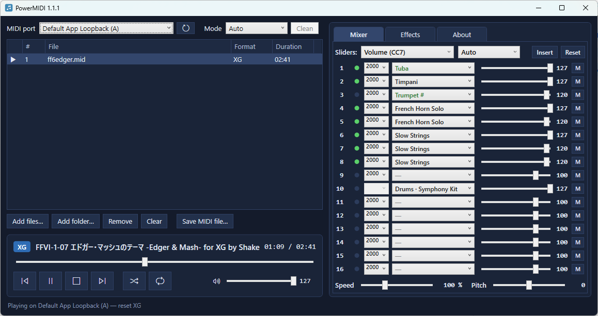

# PowerMIDI

MIDI file player and editor for Windows, made for hardware or software sound modules :
- **Roland Sound Canvas Series**: 88emuPlayer, Nuked-SC55-P256, Roland SC-8850 and other GS modules
- **Yamaha MU Series**: S-MU2000, Yamaha MU2000EX, Yamaha MU50, S-YXG50 and other XG modules
- **Roland MT-32**: MuntVSTi or Roland MT-32 / CM-64
- **General MIDI Level 1 and 2**: Too much devices and software !



## Features

- **Player**: Playback speed, transposition, play a channel with keyboard ! (click on a channel number in Mixer page)
- **Playlist**: Files and folders, drag and drop, shuffle, repeat modes...
- **Library**: Browse and play MIDI collections downloaded from archive.org (see Credits) with folder navigation, filters, random function...
- **Modes**: GM, GM2, GS, XG and MT-32, detected from file or forced with matching reset. Custom SysEx patches detected from XG and MT-32 modes.
- **Mixer**: Mute/Solo, activity and controller slider per channel (modulation, volume, pan, reverb,
  chorus, delay/variation, filter and envelope settings) with full instrument names for each mode.
- **Effects**: Reverb, Chorus, Delay, EQ, EFX, Drums, Part in GS mode - Reverb, Chorus, Variation, Insertion, Multi-EQ, Drums, Part in XG -
  Reverb, Drums, Part in MT-32 - Reverb, Chorus, Drums, Part in GM2.
- **Event editor**: List all events from file and editing with filters, add, append and replace functions.
- **Saving**: Changed settings in Mixer/Effects tabs and event editor can be written into a MIDI file.
- **File loops markers**: `loopStart` / `loopEnd`, `[` / `]` markers and CC111 are followed, can be edited.
- **LCD module support**: Show text, karaoke lyrics or dot pictures from file during playback.
- **Color themes**: Built-in XAML themes.


## Next-Steps

- A better application icon.
- Built-in SoundFont (SF2) files support.

## Requirements

- Windows 10 or 11, 64-bit.
- [.NET 10 Desktop Runtime](https://dotnet.microsoft.com/download/dotnet/10.0) or download standalone version.
- A MIDI output device (a hardware module, software, VST or included with Windows).

## Building

With [.NET 10 SDK](https://dotnet.microsoft.com/download/dotnet/10.0):

```
cd src
dotnet publish -c Release
```

## Credits

- MIDI playback and file handling: [DryWetMIDI](https://melanchall.github.io/drywetmidi/) by Maxim Dobroselsky.
- Module definition files: based on XML files of [Domino](http://takabosoft.com/) by Takabo Soft.
- Sources for archive.org : [VGMusic.com 2018 archive](https://archive.org/details/31581VideogameMusicMIDIFileswReplayGain8mbgmsfx.sf2), [Sound Canvas MIDI Collection] (https://archive.org/details/sound_canvas_midi_collection) and [Yamaha XG Free Data Collection] (https://archive.org/details/yamaha-xg-free-data)

See [THIRD-PARTY-NOTICES.md](THIRD-PARTY-NOTICES.md) for details.
